<div align="center">




</div>

## ✨ About

**Learning Journey** is an iOS app that helps you build a daily learning habit. Pick what you want to learn and how long you want to commit to it — a week, a month, or a year — then log every day as *Learned* or *Freezed* to keep your streak alive.



---

## 📱 Screenshots



---

## 🚀 Main Features

| | Feature | Description |
|:-:|---|---|
| 🎯 | **Set a learning goal** | Choose a topic (e.g. Swift) and a duration: Week, Month, or Year. |
| 🔥 | **Log a day as Learned** | One tap marks today as learned and grows your streak. |
| ❄️ | **Freeze a day** | Busy day? Use a Freeze to protect your streak. |
| ↩️ | **Undo with one tap** | Tapped by mistake? Tap the same button again to undo. |
| 📆 | **Weekly overview** | See this week at a glance, color‑coded by status. |
| 🗓️ | **Full calendar** | Browse every learned and freezed day across the year. |
| ✏️ | **Edit your goal** | Change the topic or duration anytime (with a confirmation alert). |
| 🏆 | **Goal results** | When the goal ends, see if you reached it and set a new one. |
| 💾 | **Saved automatically** | Your goal and progress stay after closing the app. |

---

## 📏 App Rules



**Freezes per goal**

| Duration | Days | Freezes |
|---|:-:|:-:|
| Week | 7 | 2 |
| Month | 30 | 8 |
| Year | 365 | 96 |

**Streak**
- The streak resets if **more than 32 hours** pass without logging a day as Learned or Freezed.
- The streak starts over when the learning goal is updated.
- Counts read **"1 day"** and **"2 days"**: singular and plural handled correctly.

**Freeze button**
- Disabled when all freezes for the goal are used.

---

## 🏗️ Architecture: MVVM

```
challengelearning
├── Models          → the shape of the data
│   ├── DayStatus.swift         (enum: notLearned · learned · freezed)
│   ├── DayLog.swift            (struct: date + status)
│   ├── LearningDuration.swift  (enum: week · month · year)
│   └── LearningGoal.swift      (struct: topic + duration + start date)
│
├── ViewModels      → the logic
│   ├── AppViewModel.swift
│   ├── ActivityViewModel.swift
│   ├── GoalResultViewModel.swift
│   ├── LearningGoalViewModel.swift
│   └── CalendarViewModel.swift
│
└── Views           → what the user sees
    ├── ContentView.swift
    ├── OnboardingView.swift
    ├── ActivityView.swift
    ├── GoalResultView.swift
    ├── LearningGoalView.swift
    ├── CalendarView.swift
    └── DurationPicker.swift    (reusable component)
```

- **Models** only describe data: no logic, no UI.
- **ViewModels** make the decisions (Is the streak broken? Can I freeze today?).
- **Views** only display what the ViewModel prepares.

---

## 🛠️ Technologies

| | |
|---|---|
| **Language** | Swift |
| **UI** | SwiftUI |
| **Design** | Liquid Glass (`glassEffect`, `glassProminent`) |
| **State** | `@State`, `@Binding`, `@Observable` |
| **Navigation** | `NavigationStack`, `NavigationLink` |
| **Persistence** | `UserDefaults` + `Codable` (JSON) |
| **Dates** | `Calendar`, `Date`, `FormatStyle` |
| **Tools** | Xcode, Git & GitHub |

---

## 📚 What I Learned

- Modeling data with **Structs** and **Enums**, and when to use a **Class** instead.
- Using **Optionals** safely with `if let`, `guard let`, and `??`.
- Separating code with the **MVVM** pattern.
- Sharing state between screens with `@State`, `@Binding`, and `@Observable`.
- Saving and loading data with **Codable** and **UserDefaults**.
- Working with dates: weeks, months, and time intervals.
- Writing **clean, reusable code** (DRY) and managing a project with **Git**.

---

## ▶️ Getting Started

1. Clone the repository
   ```bash
git clone https://github.com/RaghadALrasheed/challengelearning.git
   ```
2. Open `challengelearning.xcodeproj` in **Xcode 26** or later.
3. Choose an iPhone simulator and press **⌘ R**.

---

## 🍎 Project Context

Built as part of a coding challenge at the **Apple Developer Academy**. The app idea and UI designs were provided by the Academy; I implemented the app and its logic in Swift and SwiftUI.

---


<div align="center">

Built with 🧡 by **Raghad Alrasheed** · Apple Developer Academy Challenge

</div>
